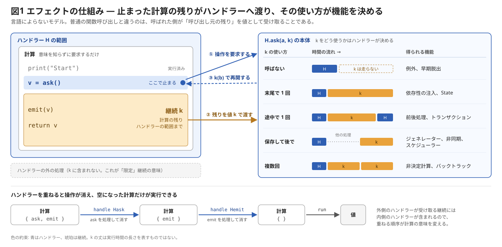
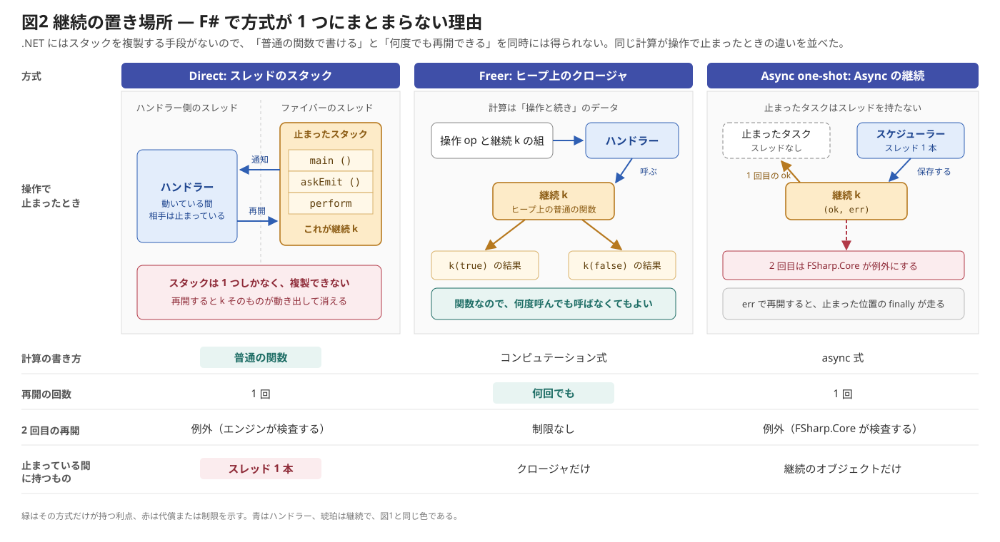
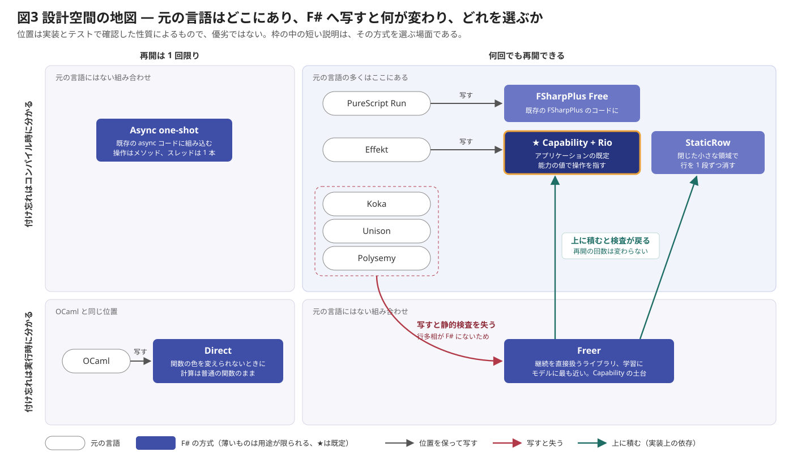

# EffectSystem

エフェクトシステムの考え方を言語によらない形で整理し、Koka / Effekt / Unison / OCaml / Polysemy / PureScript Run のエフェクトハンドラーを F# で再現したサンプルです。学習と設計検討のためのもので、本番向けのライブラリではありません。

- [エフェクトシステムとは](#エフェクトシステムとは): 特定の言語によらないモデル
- [F# で実現する場合の課題と解決](#f-で実現する場合の課題と解決)
- [サンプルの設計思想](#サンプルの設計思想)
- [方式の選び方](#方式の選び方)
- [構成](#構成)

関連する文書は次のとおりです。

- [docs/porting-notes.md](docs/porting-notes.md): 元資料の読解、エンジンごとの実装、各言語との対応、実測値、制限
- [docs/row-polymorphism-report.md](docs/row-polymorphism-report.md): SRTP で行多相をどこまで模倣できるかの検証
- API ドキュメント: XML コメントから生成します。型の設計思想はここにあります（[生成のしかた](#ドキュメントの生成)）

## 動かし方

.NET SDK 10 が必要です。

```powershell
# 記事とマニュアルの例をすべて実行する
dotnet run --project samples/EffectSystem.Samples

# テスト (Release で動かすときは -c Release を付ける)
dotnet run --project tests/EffectSystem.Tests

# コストの計測
dotnet run -c Release --project samples/EffectSystem.Samples -- bench

# スタックの限界の計測 (1 MB のスタックで動かします。溢れるとプロセスごと落ちます)
dotnet run -c Release --project samples/EffectSystem.Samples -- limit direct-ctl 100000
```

`limit` のエンジン名は `plain-recursion`、`direct-fn`、`direct-ctl`、`freer-fn`、`freer-ctl`、`freer-left`、`freer-tail-do` です。

### ドキュメントの生成

[fsdocs](https://fsprojects.github.io/FSharp.Formatting/commandline.html) で、XML コメントから API ドキュメントを生成します。この README と `docs/` の文書もサイトに含まれます。

```powershell
dotnet tool restore

# output/ に生成する
dotnet fsi scripts/build-docs.fsx

# 生成して http://localhost:8901 で表示する (編集も反映されます)
dotnet fsi scripts/build-docs.fsx --watch
```

`output/` のリンクはサイトのルートを基準にしているので、ファイルを直接開かず、`--watch` を使うか、HTTP サーバーで配信して表示してください（例: `python -m http.server --directory output`）。

fsdocs は XML コメントの `<code>` をすべて F# として色付けします。Koka や OCaml のコードの色は目安として見てください。

## エフェクトシステムとは

エフェクトシステムは、計算を「何をしたいか」と「それをどう実現するか」に分ける仕組みです。計算は操作を要求するだけで、その意味は計算を囲むハンドラーが決めます。ハンドラーは要求と一緒に「計算の残り」を受け取るので、例外、非同期、ジェネレーターのような制御の仕組みも同じ枠組みで書けます。

[](docs/figures/es-fig1-mechanism.svg)

左は `ask()` で止まった計算で、琥珀の部分が継続、つまり計算の残りです。中央の番号の順に、操作を要求し、残りを値として渡し、答えを持って再開します。呼ばれた側が呼び出し元の残りを値として受け取るところが、普通の関数呼び出しとの違いです。右は同じハンドラーの本体を 5 通りに書いたときの時間の流れで、下段はハンドラーを重ねるごとに操作が消えていく様子です。図は Deep ハンドラーだけを描いています。

以下、この図の各要素を順に定義します。

「エフェクトシステム」は狭い意味では、計算が起こしうる効果を型で追跡する型システムを指します（[Lucassen & Gifford 1988](https://bibtex.github.io/POPL-1988-LucassenG.html)）。ここでは操作とハンドラーの仕組み全体を指す広い意味で使い、型による追跡は[設計軸](#実装を分ける設計軸)の 1 つとして扱います。

### 操作とエフェクト

**操作**は「`A` を渡すと、いずれ `B` が返ってくる」という要求です。**エフェクト**は操作の集まりです。どちらもシグネチャだけで、実装を持ちません。

```text
op : A ⇝ B

Ask V   = { ask  : () ⇝ V }
Emit V  = { emit : V  ⇝ () }
State S = { get  : () ⇝ S,  put : S ⇝ () }
```

### 計算

エフェクト `E` を使って `R` を返す**計算**は、次のどちらかの状態にあります。

```text
Comp(E, R) = return(r)     r : R を返して終わった
           | op(a, k)      op を引数 a で要求して止まっている
                           k : B → Comp(E, R) は答えを受け取った後の計算の残り (継続)
```

つまり計算は、操作を節とする木です。

```text
プログラム              木
v = ask()               ask((), λv.
emit(v)                   emit(v, λ_.
return v                    return(v)))
```

計算をつなげると、木の葉に次の計算が接ぎ木されます。

```text
return(r) >>= f = f(r)
op(a, k)  >>= f = op(a, λb. k(b) >>= f)
```

「代数的」は、計算を「操作を演算記号とする項」、つまりこの木として扱う見方に由来します。2 行目の等式は、そのような操作が満たす性質で、後続の計算が操作の内側へ分配されることを表しています（[Plotkin & Power 2003](https://homepages.inf.ed.ac.uk/gdp/publications/alg_ops_gen_effects.pdf)）。

### ハンドラー

**ハンドラー**は、この木を畳み込んで別の計算へ変える関数です（[Plotkin & Pretnar 2009](https://bibtex.github.io/ESOP-2009-PlotkinP.html)）。

```text
handle H (return(r)) = H.return(r)
handle H (op(a, k))  = H.op(a, λb. handle H (k(b)))    H が op を扱うとき
                     = op(a, λb. handle H (k(b)))      扱わないときは外側へ転送する
```

`H.op` が受け取る第 2 引数が `resume` と呼ばれるものです。これを呼ぶと、止まっていた計算が再開します。

型で見ると、ハンドラーは扱ったエフェクトを消します。すべて消えた計算だけが実行できます。

```text
handle H : Comp(E ∪ F, R) → Comp(F, R')
run      : Comp(∅, R) → R
```

### 実行の例

```text
Hask  = { ask(_, k)  = k("x") }
Hemit = { emit(m, k) = print(m); k(()) }

program = ask((), λv. emit(v, λ_. return(v)))

handle Hask program
  → handle Hask emit("x", λ_. return("x"))    k("x") で再開した
  → emit("x", λ_. return("x"))                Hask は emit を扱わないので転送した。ask は消えた

handle Hemit emit("x", λ_. return("x"))
  → print("x"); return("x")                   emit も消えた

run return("x") = "x"
```

`program` は `ask` がどこから値を取るのか、`emit` が何をするのかを知りません。`Hask` を固定値に、`Hemit` をリストへの蓄積に差し替えれば、`program` を変えずにテストできます。

### 継続の使い方が機能を決める

ハンドラーが継続 `k` をどう使うかによって、まったく別の機能になります。専用の構文に見えていたものが、同じ仕組みの使い方の違いとして説明できます。

| `k` の使い方 | 得られる機能 | ハンドラーの形 | サンプル |
|---|---|---|---|
| 呼ばない | 例外、早期脱出 | `raise(e, _) = return(Error e)` | [KokaStyle.fs](samples/EffectSystem.Samples/KokaStyle.fs) の `tryResumable` |
| 末尾で 1 回 | 依存性の注入、Reader | `ask(_, k) = k(v)` | [KokaStyle.fs](samples/EffectSystem.Samples/KokaStyle.fs) の `askHandler` |
| 途中で 1 回 | 前後処理、トランザクション | `op(a, k) = 前処理; r = k(b); 後処理; r` | |
| 状態を渡しながら 1 回 | State | `get(_, k) = λs. k(s)(s)` | [Advanced.fs](samples/EffectSystem.Samples/Advanced.fs) の `runState` |
| 保存して後で | ジェネレーター、非同期、スケジューラー | `yield(v, k) = Cons(v, k)` | [OCamlManual.fs](samples/EffectSystem.Samples/OCamlManual.fs) の `invert`、`run` |
| 複数回 | 非決定計算、バックトラック | `choose(_, k) = k(true) ++ k(false)` | [Advanced.fs](samples/EffectSystem.Samples/Advanced.fs) の `runAll` |

### ハンドラーの順序が意味を決める

外側のハンドラーが捕捉する継続には、内側のハンドラーが含まれます。そのため順序を変えると結果が変わります。

```text
program = b = choose(); s = get(); put(s + 1); return (b, s)

handle NonDet (handle State(0) program)  → [((true, 0), 1), ((false, 0), 1)]    分岐ごとに状態が複製される
handle State(0) (handle NonDet program)  → ([(true, 0), (false, 1)], 2)         分岐をまたいで状態が共有される
```

モナド変換子の積み順と同じ現象です。順序は欠陥ではなく、計算の意味を選ぶ手段になります（[Advanced.fs](samples/EffectSystem.Samples/Advanced.fs) の `stateInsideNonDet`、`stateOutsideNonDet`）。

### 実装を分ける設計軸

ここまでのモデルは共通で、実装によって次の点が異なります。

| 軸 | 選択肢 | 決まること |
|---|---|---|
| 継続の表現 | スタックの断片 / ヒープ上のデータ | 再開の回数とコスト。スタックは複製しなければ安価だが 1 回限りで、データなら何回でも再開できる |
| ハンドラーの範囲 | Deep / Shallow | 継続にハンドラーを含むか。Deep は `handle H (k(b))` を渡し、Shallow は `k(b)` を渡す。Shallow なら次の操作の前にハンドラーを替えられる |
| ハンドラーの探し方 | 動的（最も近いもの）/ 字句（能力） | 同じ種類のハンドラーが重なったときの呼び先 |
| 静的検査 | 型で追跡 / 能力のスコープ / なし | ハンドラーの付け忘れを検出する時期 |
| 計算の書き方 | 直接 / モナド | 普通の関数のまま書けるか |

既存の言語は、この空間の中の点として位置づけられます。

| 軸 | Koka | Effekt | Unison | OCaml | Polysemy | Run |
|---|---|---|---|---|---|---|
| 再開の回数 | 多 | 多 | 多 | 1（実行時検査） | API による | API による |
| ハンドラーの範囲 | Deep | Deep | 手で再インストール | Deep / Shallow | Deep | Deep / 手書き |
| 探し方 | 最も近いもの | 字句（能力） | 最も近いもの | 最も近いもの | 最も近いもの | 最も近いもの |
| 静的検査 | あり | あり | あり | なし | あり | あり |
| 書き方 | 直接 | 直接 | 直接 | 直接 | do 記法 | do 記法 |

### Algebraic Effects と Extensible Effects

どちらも上のモデルの実現方法です。前者は言語やランタイムに組み込まれることが多く、操作を呼ぶと制御がすぐハンドラーへ移るように見えます。後者は木をライブラリのデータとして持ち、後から解釈します。

後者では継続が暗黙で 1 回だけ再開されるとよく説明されますが、それは `interpret` のような API の性質で、方式の制約ではありません。実際、Run の `runChoose` は継続を 2 回呼び、`runExcept` は 1 回も呼びません（[確認の詳細](docs/porting-notes.md#13-記事を移植の指針にするときの補正)）。

## F# で実現する場合の課題と解決

F# には限定継続も GADT も高カインド型も行多相もありませんが、エフェクトハンドラーの意味論は標準の F# だけで再現できます。記事の 6 言語の例とマニュアルの例は、出力まで一致する形で動きます（差は 1 点だけで、[移植ノート](docs/porting-notes.md#3-6-言語との対応)に記録しています）。

### モデルとの対応

先に、モデルと F# の対応を示します。Freer エンジンがモデルに最も近い実装です。

| モデル | F# |
|---|---|
| 操作 `ask : () ⇝ V` | `Effect<'v>` を実装する `Ask<'v>` |
| 計算 `Comp(E, R)` | `Eff<'a>`（`E` は型に現れない） |
| `return(r)` / `op(a, k)` | `Pure r` / `Impure(op, k)` |
| `>>=` | `eff { }` の `let!` |
| 操作の要求 | `Eff.perform Ask` |
| `H.op(a, k)` | `Eff.ctl (fun op resume -> ...)` |
| `H.return` | `Eff.handleWith` の第 1 引数 |
| `handle H` | `Eff.handle [ ... ]` |
| `run` | `Eff.run` |

`continue` と `pure` は F# の予約語（FS0046）なので、API は `resume` と `ret` にしています。

```fsharp
open EffectSystem
open EffectSystem.Freer

type Ask<'v> =
    | Ask

    interface Effect<'v>

let program: Eff<string> =
    eff {
        let! (name: string) = Eff.perform Ask
        return "Hello, " + name
    }

program
|> Eff.handle [ Eff.ctl (fun (_: Ask<string>) resume -> resume "world") ]
|> Eff.run
// "Hello, world"
```

F# にはモデルを直接書くための機能がいくつか欠けています。以下、課題ごとに解決と代償を示します。

### 課題 1: 継続を取り出す手段がない

OCaml の `perform` や Koka の `resume` の土台である限定継続が .NET にはなく、スタックを切り替えることも複製することもできません。そこで継続の置き場所を 3 通り用意しました。

[](docs/figures/es-fig2-continuation.svg)

3 つの列は、同じ計算が操作で止まったときの様子で、琥珀が継続の実体です。「普通の関数」と「何回でも」が同じ列にないことが、F# で方式が 1 つにまとまらない理由です。

| 方式 | 継続の置き場所 | 計算の書き方 | 再開の回数 | 代償 |
|---|---|---|---|---|
| Direct | 専用スレッドのスタック | 普通の関数 | 1 回 | ファイバーごとにスレッドを 1 本使う |
| Freer | ヒープ上のクロージャ | `eff { }` | 何回でも | 計算が `Eff<'a>` になり、呼び出し元にも波及する |
| Async one-shot | `Async` の継続 | `async { }` | 1 回 | 計算が `Async<'a>` になり、操作はメソッドとして渡す |

Direct はスレッド間で実行権を手渡しして、同時に動くスレッドを常に 1 つに保ちます。スレッドのスタックは複製できないので、再開が 1 回に限られます。OCaml がワンショットである理由と同じ制約が、F# でも同じ形で現れます。

`Async.FromContinuations` の `(ok, err, cancel)` はそのまま継続に使えます。`ok` が OCaml の `continue`、`err` が `discontinue` に当たり、2 回目の呼び出しは FSharp.Core が例外にします。

### 課題 2: 操作の答えの型を表せない

OCaml の `type _ Effect.t += Ask : string Effect.t` は、後から足せるバリアントと GADT の組み合わせです。F# の判別共用体は閉じていて、GADT もありません。

答えの型だけを持つ印のインターフェイスを用意し、判別共用体に実装させることで解決しました。

```fsharp
type Effect<'a> =
    interface
    end

type Ask<'v> =
    | Ask

    interface Effect<'v>

type Emit<'v> =
    | Emit of 'v

    interface Effect<unit>
```

- インターフェイスなので、誰でも後から操作を足せます。
- .NET のジェネリクスは実行時に残るので、`Ask<string>` と `Ask<int>` は別の操作として区別できます。OCaml で functor が必要だった場面が 1 行で済みます。
- ハンドラーの分岐は `ctl<'E, 'x, 'r when 'E :> Effect<'x>>` という形で受けます。`'E` が決まれば答えの型 `'x` が決まり、`resume` の型も決まります。

内部には `obj` と `unbox` が残りますが、`perform` と `ctl` の中に閉じ込めているので、利用者はキャストを書きません。

**代償:** 操作の網羅性は検査されません。F# の関数はランク 2 多相を引数に取れないので、OCaml の `effc` のように 1 つの `match` にまとめられず、分岐のリストになります。また、型が同じ操作はすべて同じ操作として扱われるので、要素型が同じ `invert` を入れ子にすると、外側の操作を内側のハンドラーが受けてしまいます。OCaml は呼び出しごとに局所モジュールで新しい操作を作れますが、型で探す方式では同じことができません（能力で探す方式なら混ざりません）。

### 課題 3: 高カインド型がない

Haskell の `Free f` は任意の Functor を、Polysemy の `Sem r` はエフェクトのリストを型引数に取ります。いずれも型コンストラクターを型引数に渡す機能が前提ですが、F# にはありません。

木の型を `Eff<'a>` の 1 つに固定して解決しました。節には操作を `obj` として入れるので、エフェクトの和も Functor の定義も要りません。

```fsharp
type Eff<'a> =
    | Pure of 'a
    | Impure of effect: obj * resume: (Result<obj, exn> -> Eff<'a>)
    | Delayed of (unit -> Eff<'a>)
```

`resume` が `Result` を受け取るのは、値だけでなく例外でも再開するためです。`Delayed` は課題 6 で使います。

FSharpPlus の `Free<'F<'T>, 'T>` は SRTP で高カインド型を模倣する別解で、比較のため [src/EffectSystem.Plus/](src/EffectSystem.Plus/) に実装しています。

### 課題 4: 行多相がない

Koka の `<ask<a>, emit<a> | e>` はハンドラーを被せるたびに 1 つ消えますが、F# に行はありません。これがエフェクト安全性に関わる最大の課題です。

| 方式 | 検査の仕組み | 付け忘れの結果 | 制限 |
|---|---|---|---|
| Freer 単体 | なし | `Eff.run` で実行時に `Unhandled` | |
| Capability | 能力を値として引数で受ける | 能力がないので呼び出せない | 引数が増える。ハンドラーの外へ持ち出した能力は実行時に `Unhandled` |
| Rio | インターフェイス制約 | FS0193 | 行は最後にまとめて閉じる。`IAsk<int>` と `IAsk<string>` を同時に要求できない |
| RecordEnv | メンバー制約 | FS0001 | 行は最後にまとめて閉じる。環境を型変数のまま扱う関数には `inline` が要る |
| StaticRow | 幽霊型のスロット | FS0001 | 1 段ずつ消えるが、エフェクトの追加で全シグネチャが変わる |

要点は、行とは「必要なものの一覧」だということです。その値を渡すことにすれば、スコープが行と同じ役割を果たします。これは Effekt の能力渡しと同じ考え方です。

```fsharp
// def askHandler[R, A](a : A) { action: () => R / Ask[A] }: R / {} = {
//   try { action() } with Ask[A] { def ask() = resume(a) }
// }
let askHandler (a: 'a) (action: IAsk<'a> -> Eff<'r>) : Eff<'r> =
    reset (fun prompt ->
        action
            { new IAsk<'a> with
                member _.Ask() = shift prompt (fun resume -> resume a) })
```

能力の引数を省きたいときは `Rio` を使います。注釈がなくても、必要なエフェクトの一覧が型として推論されます。

```fsharp
let askEmitRow (out: Log) =
    rio {
        out "Start"
        let! v = ask ()
        do! emit v
        out "End"
    }

// val askEmitRow:
//   out: Log -> Rio<'a,unit> when 'a :> IEmit<'b> and 'a :> IAsk<'b>
```

環境のクラスを書きたくないときは `RecordEnv` を使います。インターフェイス制約を SRTP のメンバー制約に置き換えると、レコードをそのまま環境にできます。

```fsharp
let inline ask () : Rio< ^R, 'v> when ^R: (member Ask: IAsk<'v>) =
    Rio(fun env -> (^R: (member Ask: IAsk<'v>) env).Ask())

// AppEnv のクラスも転送も要らない。
askEmit out |> Rio.run {| Ask = ask; Emit = emit |}
```

フィールドの名前がラベルの役割を果たすので、`IAsk<int>` と `IAsk<string>` も名前を分ければ同時に要求できます。ただし、行を 1 段ずつ消す手段にはなりません。SRTP で行多相をどこまで模倣できるかは[検証レポート](docs/row-polymorphism-report.md)にあります。

### 課題 5: 直接スタイルで書けない

Freer の計算はモナドなので、`perform (Xchg 0) + perform (Xchg 1)` のように式の途中で操作を呼べません。コンピュテーション式の `let!` で 1 つずつ束縛します。普通の関数のまま書く必要があるときは Direct を使います。

一方、Koka と Effekt の `with` 糖衣はそのまま再現できます。`with h` は `h (fun cap -> 残り)` の糖衣なので、`Bind` を関数適用にしたビルダーで同じ形になります。

```fsharp
// with askHandler("Ask Value")
// with emitHandler
// askEmit[String]()
handlers {
    let! ask = askHandler "Ask Value"
    let! emit = emitHandler out
    return! askEmit ask emit out
}
|> Eff.run
```

### 課題 6: スタックが伸びる

末尾で再開するだけのハンドラーでも、素直に書くと「ハンドラー → `resume` → 次のハンドラー」と操作の回数だけ呼び出しが積まれます。F# の `.tail` 呼び出しは Debug では既定で無効で、頼れません。

Freer では再開を `Delayed` で包み、`Eff.run` のループへ戻すトランポリンにしました。継続を受け取らない `Eff.fn` は、答えをその場で渡して進みます。これは自己末尾呼び出しなので、コンパイラがループにします。どちらも `Tailcalls=false` の Debug ビルドで、1 MB のスタックで 100 万回の操作が完走します。

末尾の `do!` にも注意が必要です。`do! m` は末尾にあっても既定では `Bind` になるので、`do!` で再帰すると `bind` が左にネストし、全体のコストが深さの 2 乗になります。F# 10 のコンパイラは、ビルダーに `ReturnFromFinal` があれば末尾の `return!` と `do!` をそれへ脱糖します（[FS-1330](https://github.com/fsharp/fslang-design/blob/main/FSharp-10.0/FS-1330-support-tailcalls-in-computation-expressions.md)）。`m` をそのまま返すようにして、コストを深さによらないものにしました。`try` の中は末尾として扱われないので、例外の捕捉は変わりません。

Direct にはこの方法が使えないので、Koka の `ctl` と `fun` の区別を持ち込みました。末尾再開と決まっている `Deep.fn` はエンジン内のループで答えを返すのでスタックが伸びません。`Deep.ctl` は `.tail` に依存し、`Tailcalls=false` では 5,000 回の操作で溢れました。[Directory.Build.props](Directory.Build.props) で `Tailcalls=true` にしているのはこのためです。

### 課題 7: マルチショットと可変状態

継続のクロージャを何度呼んでも、そこに捕捉された可変状態は複製されません。F# には次の落とし穴があり、テストで挙動を固定しています。

- **`let mutable`:** クロージャに捕捉されると暗黙に参照セルになるので、`eff` の中で使うと再開をまたいで共有されます。分岐ごとに独立なら `[1; 1]` になる計算が `[1; 2]` になります。状態はエフェクトか引数で持ってください。
- **`for`:** 列挙子は可変なので、そのまま使うと再開のたびに壊れます。`eff` の `For` は先に不変リストへ変換しています。そのため無限列は扱えません。
- **`finally`:** 再開ごとに走り、再開されずに捨てられた経路では走りません。確実に走らせるには `Eff.ctlK` の `k.Discontinue` で再開します。

このほかに踏んだ問題（FSharpPlus の `Coproduct` が実行時に落ちる件、`Async` の継続がスレッドプールへ回される件）は[移植ノート](docs/porting-notes.md)に記録しています。

## サンプルの設計思想

### 操作の宣言を実行方式から切り離す

操作はシグネチャに過ぎない、というモデルの考え方をそのまま型にしました。`Ask<'v>` は `Effect<'a>` にしか依存しないので、同じ型を Direct でも Freer でも処理できます。計算の書き方は変わりますが、宣言は変わりません。

### 万能の 1 つにまとめず、小さなエンジンを並べる

.NET にはスタックを複製する手段がないので、直接スタイルとマルチショットを同時には得られません。トレードオフが原理的なものなら、1 つの API の裏に隠すよりも、選べる形で並べるほうが理解の助けになります。

```text
Effect<'a>                     操作の宣言
 ├─ Direct       161 行        スレッドのスタックに継続を置く
 └─ Freer        153 行        ヒープ上のクロージャに継続を置く
     ├─ Capability + Rio  57 行    型ではなく能力で操作を探す
     │   └─ RecordEnv (サンプル)   レコードを環境にする
     └─ StaticRow (サンプル)       幽霊型で行を表す

Effect<'a> を使わない別系統
 ├─ Async one-shot (サンプル)      操作はメソッド、継続は Async のもの
 └─ FSharpPlus Free    66 行       操作は Functor、PureScript Run の形
```

行数はコメントと空行を除いたものです。どれも一度に読み切れる大きさに抑えています。Capability が短いのは、Freer に「型の代わりに目印で探す」分岐を 1 つ足すだけで実現できるからです。

### 元の言語の形を残す

サンプルは言語ごとにファイルを分け、元のコードを XML コメントとしてすぐ上に置いています。API ドキュメントにも同じ形で載ります。名前も `ctl`、`fn`、`resume`、`retc` / `exnc` / `effc`、`matchWith`、`interpret`、`handlers` のように元の言語に合わせ、並べて読めるようにしました。

```fsharp
/// <summary>ask に固定値で答えるインタープリター。</summary>
/// <remarks>
/// <code lang="haskell"><![CDATA[
/// runAsk :: v -> Sem (Ask v ': r) a -> Sem r a
/// runAsk value = interpret $ \case
///   Ask -> pure value
/// ]]></code>
/// </remarks>
let runAsk (value: 'v) (m: Eff<'a>) : Eff<'a> =
    m |> Eff.handle [ Eff.interpret (fun (_: Ask<'v>) -> Eff.ret value) ]
```

### 型の穴はライブラリの内側に閉じ込める

GADT がない以上、どこかにキャストは必要です。それを `perform` と分岐の生成関数に集め、利用者のコードには出さないようにしました。

### スタック安全性を最適化に依存させない

ビルド設定で結果が変わるエンジンは信頼しにくいので、Freer はトランポリンとループで `.tail` への依存をなくしました。依存が残る Direct の `ctl` については、依存していることと限界の実測値を明記しています。

### 主張は実行して確かめる

- 期待値には、記事とマニュアルに掲載された実行結果をそのまま使います。
- コンパイルエラーになるという主張は [tests/compile-fail/](tests/compile-fail/) のスクリプトで検証します。通るスクリプトを対照群として並べ、狙いどおりの理由で失敗していることを確かめます。
- FSharpPlus の挙動のような外部の事実もテストで固定し、版を上げて変わったら分かるようにしています。
- 計測のコマンドもリポジトリに入れ、数値を再現できるようにしています。

### 依存を増やさない

`EffectSystem` 本体は FSharp.Core だけに依存します。FSharpPlus は別プロジェクト、Expecto はテストだけで使います。継続の操作には判別共用体と関数で足りるので、FSharpPlus は必須にしていません。

### やらなかったこと

本番向けのライブラリではないので、次の点は実装していません。必要になれば、まずここから手を入れることになります。

- Freer の左ネストの改善（型整列キュー）
- Direct のスレッドプール化と、再開されなかったファイバーの後始末
- SRTP による行の型レベル探索（開いた行を注釈できず、コンパイル時間が行の深さに対して指数的に伸びる。[理由の詳細](docs/row-polymorphism-report.md#9-判断)）

## 方式の選び方

F# では設計軸を独立に選べるわけではなく、次の 2 つが残りを強く規定します。

- **継続をどこに置くか。** スタックに置くなら直接スタイルになりますが、再開は 1 回に限られます。ヒープに置くなら再開は何回でもできますが、計算はコンピュテーション式で書くことになります。
- **操作をどう探すか。** 型で探すと記述は短いですが、検査は実行時になります。能力で探すと引数が増えますが、検査はコンパイル時になります。

[](docs/figures/es-fig3-design-map.svg)

横軸は再開の回数、縦軸はハンドラーの付け忘れを検出する時期です。白い枠が元の言語、青い枠が F# の方式で、★がアプリケーションの既定です。灰色の矢印は位置を保って写せたもの、赤は写すと位置が変わるもの、緑は実装の上に積む関係を表します。

Koka、Unison、Polysemy を Freer へ写すと、行多相がないので検査を失って下へ落ちます。失った検査は、Freer の上に Capability や StaticRow を積むと戻ります。普通の関数で書きたいなら左下の Direct しかなく、検査と複数回の再開の両方を諦めることになります。

| 目的 | 方式 | 理由 | 対応する言語 | 操作 1 回の目安 |
|---|---|---|---|---|
| アプリケーションの既定 | Capability + Rio | ハンドラーの付け忘れがコンパイルエラーになる。マルチショットも使える | Effekt | Capability は約 130 ns、Rio は約 170 ns |
| Rio の環境のクラスを書きたくない | RecordEnv | レコードをそのまま環境にできる。操作だけを `inline` にして、組み上げた計算は名前付きレコードで閉じる | Effekt | 約 170 ns（Rio と同じ） |
| 継続を直接扱うライブラリ、学習 | Freer | Koka / Unison / Polysemy の書き方をすべて写せる | Koka / Unison / Polysemy | `fn` は約 60 ns、`ctl` は約 130 ns |
| 既存の `async` コードに組み込む | Async one-shot | FSharp.Core だけで書け、タスクごとにスレッドを消費しない | OCaml の意味論 | 約 220 ns（最速経路の値） |
| 関数の色を変えられない、OCaml の例をそのまま動かしたい | Direct | 普通の関数のまま `perform` できる唯一の方式。ファイバーごとにスレッドを 1 本使う | OCaml | 約 400〜600 ns（生成は約 80 µs） |
| すでに FSharpPlus を使っていて、変換子へ解釈したい | FSharpPlus Free | `Free.fold` で任意のモナドへ畳み込める。それ以外では勧めない（[理由](docs/porting-notes.md#5-fsharpplus-を使うか)） | PureScript Run | 同じ条件で測っていない |

測定の条件と幅は[移植ノート](docs/porting-notes.md#42-コスト)にあります。

Capability でも、末尾で 1 回再開するだけの操作なら `shift` は要りません。能力のメソッドで `Eff.ret` を返せば継続を取り出さずに済み、`reset` もなくせます。コストは約 30 ns まで下がります（[EffektStyle.fs](samples/EffectSystem.Samples/EffektStyle.fs) の `askHandlerDirect`）。ただし区切りがなくなるので、ハンドラーの外へ持ち出した能力は `Unhandled` にならず、そのまま答えを返します。

## 構成

| パス | 内容 |
|---|---|
| [src/EffectSystem/Core.fs](src/EffectSystem/Core.fs) | 操作の印 `Effect<'a>` と共通の例外 |
| [src/EffectSystem/Freer.fs](src/EffectSystem/Freer.fs) | Freer エンジン |
| [src/EffectSystem/Direct.fs](src/EffectSystem/Direct.fs) | Direct エンジン（Deep / Shallow） |
| [src/EffectSystem/Capability.fs](src/EffectSystem/Capability.fs) | 能力渡し、`Rio`、`handlers` |
| [src/EffectSystem.Plus/RunStyle.fs](src/EffectSystem.Plus/RunStyle.fs) | FSharpPlus の `Free` を使った Run の移植 |
| [tests/EffectSystem.Tests/Tests.fs](tests/EffectSystem.Tests/Tests.fs) | 記事とマニュアルの出力を期待値にしたテスト |
| [tests/compile-fail/](tests/compile-fail/) | コンパイルエラーになることを確かめるスクリプトと対照群 |
| [docs/porting-notes.md](docs/porting-notes.md) | 元資料の読解、エンジンごとの実装、各言語との対応、実測値、制限 |
| [docs/row-polymorphism-report.md](docs/row-polymorphism-report.md) | SRTP で行多相をどこまで模倣できるかの検証 |
| [docs/figures/](docs/figures/) | この README の図（手書きの SVG） |
| [scripts/build-docs.fsx](scripts/build-docs.fsx) | fsdocs でサイトを生成するスクリプト。テンプレートは [docs/_template.html](docs/_template.html) |

[samples/EffectSystem.Samples/](samples/EffectSystem.Samples/) の内容は次のとおりです。

| ファイル | 内容 | エンジン |
|---|---|---|
| [KokaStyle.fs](samples/EffectSystem.Samples/KokaStyle.fs) | Koka の写し | Freer |
| [EffektStyle.fs](samples/EffectSystem.Samples/EffektStyle.fs) | Effekt の写し、字句スコープ、Rio | Capability |
| [UnisonStyle.fs](samples/EffectSystem.Samples/UnisonStyle.fs) | Unison の写し | Freer の `view` |
| [OCamlStyle.fs](samples/EffectSystem.Samples/OCamlStyle.fs) | 記事の OCaml の写し | Direct |
| [OCamlManual.fs](samples/EffectSystem.Samples/OCamlManual.fs) | マニュアル 12.24 の全例 | Direct |
| [PolysemyStyle.fs](samples/EffectSystem.Samples/PolysemyStyle.fs) | Polysemy の写し | Freer の `interpret` |
| [PureScriptStyle.fs](samples/EffectSystem.Samples/PureScriptStyle.fs) | PureScript Run の写し | FSharpPlus Free |
| [AsyncOneShot.fs](samples/EffectSystem.Samples/AsyncOneShot.fs) | `Async` の継続で書いたスケジューラー | `Async.FromContinuations` |
| [StaticRow.fs](samples/EffectSystem.Samples/StaticRow.fs) | 行を 1 段ずつ消す幽霊型 | Freer |
| [RecordEnv.fs](samples/EffectSystem.Samples/RecordEnv.fs) | レコードを環境にするメンバー制約 | Capability |
| [Advanced.fs](samples/EffectSystem.Samples/Advanced.fs) | State と NonDet、ジェネレーター、`finally` | Freer |
| [Bench.fs](samples/EffectSystem.Samples/Bench.fs) | コストとスタックの計測 | すべて |

## 参考文献

- funnycat, [Algebraic Effects と Extensible Effects：6つの言語で学ぶエフェクトシステムの違いと共通点](https://zenn.dev/funnycat/articles/9587e5dc09e4c4)
- [OCaml マニュアル 12.24 Effect handlers](https://ocaml.org/manual/5.4/effects.html)
- Lucassen, Gifford, [Polymorphic Effect Systems](https://bibtex.github.io/POPL-1988-LucassenG.html), POPL 1988
- Plotkin, Power, [Algebraic Operations and Generic Effects](https://homepages.inf.ed.ac.uk/gdp/publications/alg_ops_gen_effects.pdf), Applied Categorical Structures, 2003
- Plotkin, Pretnar, [Handlers of Algebraic Effects](https://bibtex.github.io/ESOP-2009-PlotkinP.html), ESOP 2009
- Brachthäuser, Schuster, Ostermann, [Effects as Capabilities](https://publikationen.uni-tuebingen.de/xmlui/handle/10900/123811), OOPSLA 2020
- [F# RFC FS-1330: Support tailcalls in computation expressions](https://github.com/fsharp/fslang-design/blob/main/FSharp-10.0/FS-1330-support-tailcalls-in-computation-expressions.md)

実装の確認に使ったソースコードと、その他の論文は[移植ノートの参考文献](docs/porting-notes.md#参考文献)にあります。

## ライセンス

[MIT](LICENSE) です。ただし、XML コメントと文書に引用した記事とマニュアルのコードの権利は、それぞれの著作者にあります。
